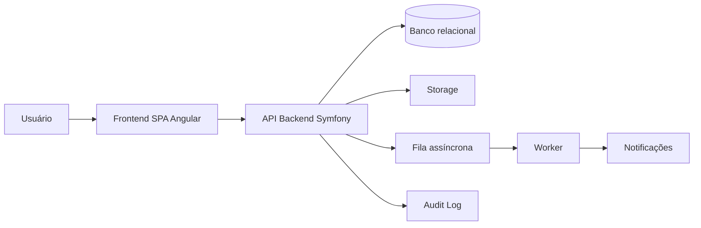

# SupportFlow — Help Desk / Service Desk

> **Status:** baseline técnica criada antes da análise de um repositório executável.
> Itens marcados como **Planejado** são propostas de arquitetura e não devem ser tratados como já implementados.
> Quando o código existir, `composer.json`, `package.json`, migrations, código-fonte, infraestrutura e testes passam a ser a fonte primária de verificação.


> **Nome provisório do projeto.**

## Objetivo

O SupportFlow é um projeto de Help Desk / Service Desk para centralizar solicitações internas e atendimento de áreas como TI, RH, Financeiro, Manutenção, Administrativo, Facilities e outros departamentos configuráveis.

O objetivo é permitir que cada empresa configure departamentos, tipos de chamado, categorias, prioridades, pipelines, filas e regras de atendimento sem depender de fluxos rígidos definidos no código.

## Estado atual verificado

Na análise dos materiais disponíveis foi encontrada uma especificação funcional detalhada do módulo de Chamados/Tickets, porém **não foi localizado um repositório executável do Help Desk** contendo frontend, backend, migrations ou infraestrutura.

Portanto:

- entidades desta documentação são **Planejadas**;
- endpoints são **contratos propostos**;
- comandos de instalação são a baseline esperada para a stack planejada;
- nenhuma tabela, migration, role, integração, job ou serviço externo é declarado como existente;
- divergências futuras entre documentação e código devem ser registradas em `Pontos encontrados durante a análise`.

## Problema que o sistema resolve

Solicitações internas costumam ficar dispersas entre WhatsApp, e-mail, mensagens privadas e planilhas. Isso dificulta priorização, rastreabilidade, SLA, distribuição de responsabilidade, auditoria e indicadores.

O sistema pretende centralizar:

- abertura e acompanhamento de chamados;
- triagem;
- atendimento;
- pipelines configuráveis;
- filas;
- atribuição;
- comentários e anexos;
- histórico operacional;
- auditoria;
- permissões granulares;
- notificações desacopladas;
- SLA e escalonamento;
- isolamento por tenant, se a arquitetura multiempresa for adotada.

## Escopo por fase

### MVP — Planejado

- autenticação;
- usuários e permissões mínimas;
- departamentos;
- tipos e categorias;
- prioridades;
- pipelines e etapas configuráveis;
- criação, listagem e detalhe de tickets;
- comentários;
- anexos;
- atribuição manual;
- movimentação entre etapas;
- histórico operacional;
- fila por prioridade e tempo de espera;
- auditoria das ações críticas.

### Fase 2 — Planejado

- SLA;
- dashboard;
- relatórios;
- notificações internas/e-mail;
- regras de atribuição;
- reabertura;
- avaliação;
- base de conhecimento;
- filtros salvos.

### Fase 3 — Planejado

- automações configuráveis;
- round-robin;
- balanceamento por carga;
- escalonamento avançado;
- webhooks;
- WhatsApp;
- analytics avançado.

## Arquitetura resumida — Planejado



## Stack planejada

| Camada | Tecnologia | Status |
|---|---|---|
| Frontend | Angular + TypeScript | Planejado |
| UI | Tailwind CSS ou solução definida no bootstrap | Planejado |
| Backend | Symfony + PHP | Planejado |
| Banco | MySQL ou PostgreSQL | A decidir |
| API | REST/JSON | Planejado |
| Auth | Bearer/JWT ou mecanismo equivalente | A decidir |
| Filas | Symfony Messenger ou equivalente | Planejado |
| Storage | Local em dev; object storage em produção | Planejado |
| Containers | Docker | Planejado |
| Testes backend | PHPUnit | Planejado |

As versões exatas devem ser fixadas pelo código e lockfiles, nunca inventadas na documentação.

## Estrutura planejada

```text
supportflow/
├── README.md
├── docs/
├── backend/
│   ├── src/
│   ├── config/
│   ├── migrations/
│   ├── tests/
│   └── composer.json
└── frontend/
    ├── src/
    ├── public/
    ├── package.json
    └── angular.json
```

## Instalação esperada

### Backend — Planejado

```bash
cd backend
composer install
cp .env .env.local
php bin/console doctrine:database:create
php bin/console doctrine:migrations:migrate
php bin/console doctrine:fixtures:load
symfony server:start
```

### Frontend — Planejado

```bash
cd frontend
npm ci
npm start
```

Estes comandos devem ser substituídos pelos scripts reais assim que o repositório existir.

## Configuração esperada

Backend:

```dotenv
APP_ENV=dev
APP_SECRET=
DATABASE_URL=
CORS_ALLOW_ORIGIN=
MESSENGER_TRANSPORT_DSN=
STORAGE_DRIVER=
```

Frontend:

```dotenv
API_BASE_URL=http://localhost:8000/api
```

Nunca commitar secrets reais.

## Ordem de leitura

1. [Getting Started](docs/01-getting-started.md)
2. [Backend](docs/02-backend.md)
3. [Frontend](docs/03-frontend.md)
4. [System Design](docs/04-system-design.md)
5. [Design System](docs/05-design-system.md)
6. [Database](docs/06-database.md)
7. [Entities](docs/07-entities.md)
8. [Screens and Flows](docs/08-screens-and-flows.md)
9. [Implementation Guidelines](docs/09-implementation-guidelines.md)
10. [API Contracts](docs/10-api-contracts.md)
11. [Security](docs/11-security.md)
12. [Authentication and Permissions](docs/12-authentication-and-permissions.md)
13. [Architecture Decisions](docs/13-architecture-decisions.md)
14. [Development Standards](docs/14-development-standards.md)

## Regras obrigatórias

1. Backend é autoridade final de autorização.
2. Nenhum acesso depende apenas de ocultar botão no frontend.
3. Dados de tenants diferentes jamais podem vazar.
4. Regras críticas não ficam apenas no frontend.
5. Controllers devem ser finos.
6. Contratos de API e implementação devem permanecer sincronizados.
7. Alterações de pipeline, prioridade, responsável e fechamento geram histórico.
8. Evitar JSON para dados que precisam de relacionamento, filtro, integridade ou relatório.
9. Reutilizar componentes e tokens antes de criar variações.
10. Alterações estruturais devem gerar ADR.

## Pontos encontrados durante a análise

### Código-fonte não disponível

**Problema:** não foi localizado backend/frontend executável do Help Desk.

**Impacto:** não é possível confirmar versões, endpoints, migrations, entidades, variáveis, autenticação, estrutura de pastas ou comportamento real.

**Recomendação:** quando o repositório for disponibilizado, realizar auditoria documental arquivo a arquivo e atualizar todos os itens `Planejado`.

### Multi-tenancy ainda precisa de decisão formal

**Impacto:** afeta praticamente todas as entidades, consultas, índices e regras de segurança.

**Recomendação:** decidir antes de implementar o domínio principal e registrar em ADR.
