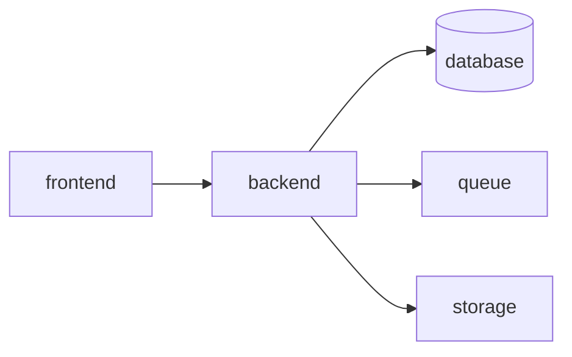

# 01 — Getting Started

> **Status:** baseline técnica criada antes da análise de um repositório executável.
> Itens marcados como **Planejado** são propostas de arquitetura e não devem ser tratados como já implementados.
> Quando o código existir, `composer.json`, `package.json`, migrations, código-fonte, infraestrutura e testes passam a ser a fonte primária de verificação.


## Objetivo

Fornecer onboarding técnico para um novo desenvolvedor.

## Estado atual

**Não implementado atualmente:** não há repositório executável disponível para validar comandos, versões e dependências.

## Bootstrap obrigatório

No primeiro commit de implementação, criar e versionar:

```text
/backend/composer.json
/backend/.env.example
/backend/.env.test
/frontend/package.json
/frontend/.env.example
/docker-compose.yml
/README.md
```

## Backend

### Pré-requisitos a registrar

- versão do PHP;
- versão do Symfony;
- versão do Composer;
- extensões PHP;
- banco;
- driver de filas;
- storage.

### Instalação planejada

```bash
cd backend
composer install
cp .env .env.local
php bin/console doctrine:database:create
php bin/console doctrine:migrations:migrate
```

Fixtures, se existirem:

```bash
php bin/console doctrine:fixtures:load
```

### Execução

```bash
symfony server:start
```

ou o comando definido em Docker/scripts do projeto.

### Testes

```bash
php bin/phpunit
```

### Debugging

- logs estruturados;
- Symfony Profiler somente em dev;
- Xdebug quando necessário;
- `.env.local` para configuração local;
- nunca ativar debug detalhado em produção.

## Frontend

### Pré-requisitos a registrar

- Node em `.nvmrc` ou equivalente;
- um único gerenciador de pacotes;
- Angular no `package.json`.

### Instalação

```bash
cd frontend
npm ci
npm start
```

### Build

```bash
npm run build
```

O script real de preview/deploy deve estar no `package.json`.

## Variáveis de ambiente

### Backend

```dotenv
APP_ENV=dev
APP_SECRET=change-me
DATABASE_URL=
CORS_ALLOW_ORIGIN=http://localhost:4200
MESSENGER_TRANSPORT_DSN=
STORAGE_DRIVER=local
```

### Frontend

A URL da API deve ser configurável. Não hardcodar host em services.

## Docker — Planejado



## Troubleshooting

| Sintoma | Causa provável | Ação |
|---|---|---|
| API sem banco | `DATABASE_URL` incorreta | validar host/porta/credenciais |
| CORS | origem não permitida | ajustar backend |
| migrations pendentes | schema desatualizado | executar migrations |
| 401 | token inválido/ausente | validar login/header |
| 403 | permissão insuficiente | conferir RBAC no backend |
| frontend sem API | ambiente incorreto | conferir base URL |
| worker parado | fila sem consumidor | verificar Messenger/logs |

## Definition of Done do ambiente

Um dev novo deve conseguir:

1. clonar;
2. copiar `.env.example`;
3. iniciar infraestrutura;
4. instalar dependências;
5. migrar banco;
6. iniciar API/frontend;
7. autenticar com fixture/documentação local;
8. executar testes.

## Pontos encontrados durante a análise

- versões exatas não verificáveis;
- banco pendente;
- auth pendente;
- Docker não comprovado por arquivo.
