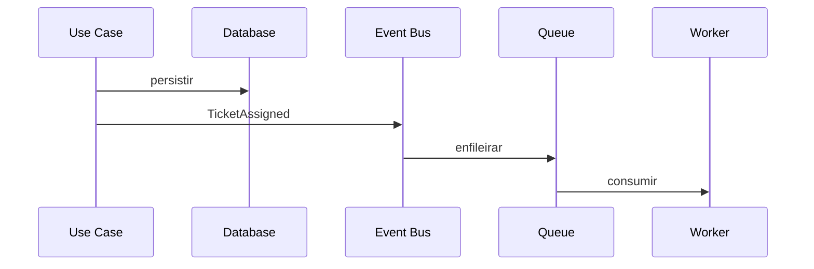

# 02 — Backend

> **Status:** baseline técnica criada antes da análise de um repositório executável.
> Itens marcados como **Planejado** são propostas de arquitetura e não devem ser tratados como já implementados.
> Quando o código existir, `composer.json`, `package.json`, migrations, código-fonte, infraestrutura e testes passam a ser a fonte primária de verificação.


## Responsabilidade

O backend é a autoridade do domínio: autenticação, autorização, tenant, transições, concorrência, persistência, histórico e auditoria.

## Stack

**Planejado:** Symfony/PHP. Versões deverão ser lidas do `composer.json`.

## Estrutura recomendada

```text
src/
├── Controller/
├── DTO/
│   ├── Request/
│   └── Response/
├── Entity/
├── Repository/
├── Security/
├── Service/
├── UseCase/
├── Event/
├── Message/
├── MessageHandler/
├── Validator/
└── Exception/
```

A estrutura pode ser reduzida, desde que preserve responsabilidades.

## Controllers

Devem:
- receber requisição;
- mapear DTO;
- executar caso de uso;
- devolver resposta.

Não devem:
- conter regra de negócio central;
- executar queries complexas;
- alterar estágio sem validar transição;
- decidir tenant manualmente de forma duplicada.

## Casos de uso planejados

- `CreateTicket`;
- `UpdateTicket`;
- `AssignTicket`;
- `MoveTicketStage`;
- `AddTicketComment`;
- `AddTicketAttachment`;
- `CloseTicket`;
- `ReopenTicket`.

## Persistência

Toda consulta multi-tenant deve carregar tenant no filtro ou usar mecanismo central equivalente.

Nunca buscar recurso apenas por ID quando isso puder permitir vazamento cross-tenant.

## DTOs

Entidade Doctrine não é contrato público.

Exemplo:

```text
CreateTicketRequest
- title
- description
- departmentId
- typeId
- categoryId?
- priorityId
```

## Validação

Separar:
- formato/required: DTO/validator;
- regra de domínio: use case/service;
- integridade estrutural: banco.

Validar:
- configurações pertencem ao tenant;
- etapa pertence ao pipeline;
- transição existe;
- responsável pertence ao tenant;
- prioridade é válida.

## Erros

Formato recomendado:

```json
{
  "error": {
    "code": "TICKET_STAGE_TRANSITION_NOT_ALLOWED",
    "message": "A transição solicitada não é permitida.",
    "details": {}
  }
}
```

## Concorrência

Atribuição e movimentação devem usar optimistic locking (`version`) ou operação atômica equivalente.

Conflito retorna `409 Conflict`.

## Eventos



Regra de negócio não envia e-mail diretamente.

## Cache

**Não implementado atualmente.** Medir antes de adicionar.

## Storage

Metadados no banco; conteúdo no storage. Abstrair driver.

## Logs

Incluir quando disponível:
- request/correlation id;
- tenant id;
- actor id;
- ação;
- resource id.

Não logar secrets/tokens.

## Testes prioritários

- pipeline;
- permissão;
- tenant;
- concorrência;
- API;
- upload.

## Pontos encontrados durante a análise

Nenhuma entity, controller, service ou configuração Symfony pôde ser verificada.
