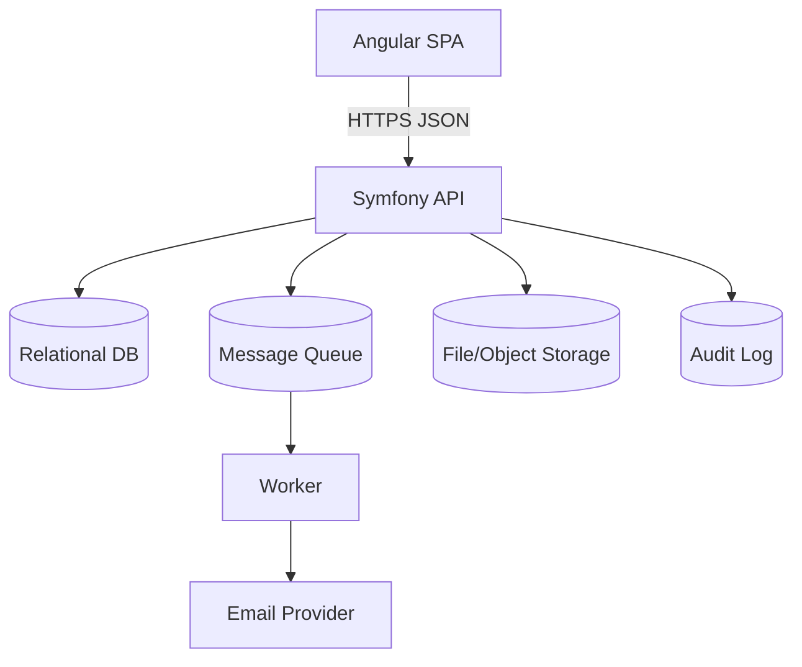
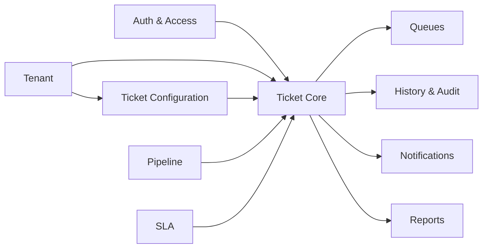
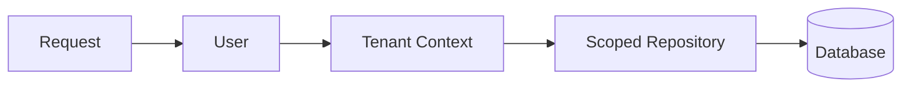
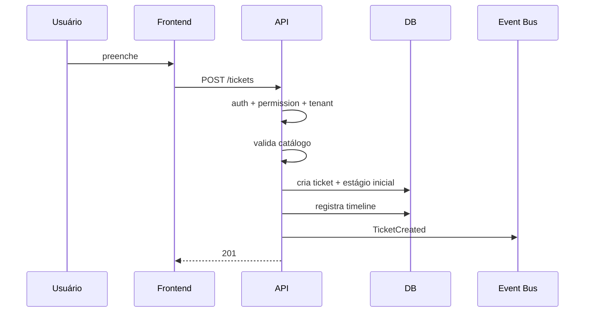
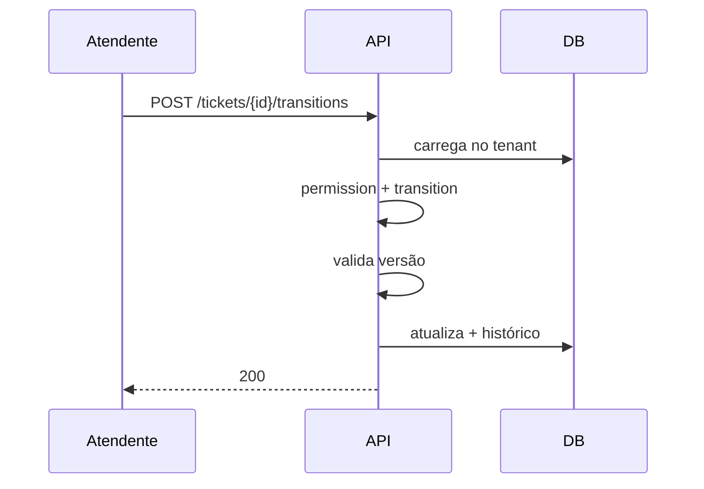

# 04 — System Design

> **Status:** baseline técnica criada antes da análise de um repositório executável.
> Itens marcados como **Planejado** são propostas de arquitetura e não devem ser tratados como já implementados.
> Quando o código existir, `composer.json`, `package.json`, migrations, código-fonte, infraestrutura e testes passam a ser a fonte primária de verificação.

## Arquitetura geral — Planejada

## Módulos

## Responsabilidades do frontend

- telas;
- filtros;
- formulários;
- kanban;
- feedback;
- consumo dos contratos.

Não decide se transição é válida.

## Responsabilidades do backend

- autenticar;
- autorizar;
- resolver tenant;
- validar configuração;
- transicionar;
- persistir;
- garantir concorrência;
- auditar;
- emitir eventos.

## Banco

Relacional para domínio principal. JSON apenas para metadados realmente dinâmicos.

## Filas/jobs

MVP pode operar sem fila avançada. Fase 2:
- e-mail;
- SLA;
- notificações;
- eventos.

Fase 3:
- webhooks;
- WhatsApp;
- automações.

## Cache

Não usar por padrão no MVP.

## Storage

Arquivos fora da tabela principal. Banco armazena metadados e `storage_key`.

## Multi-tenancy

**Decisão pendente.**

Se adotado:

Não confiar em `tenantId` livre vindo do frontend se ele puder ser inferido da sessão/token.

## Fluxo: criar ticket

## Fluxo: mover etapa

## Integridade

- configurações do mesmo tenant;
- stage pertence ao pipeline;
- transition precisa existir;
- configuração em uso é arquivada;
- histórico preserva referências;
- mudança simultânea deve gerar conflito explícito.

## Decisões arquiteturais

- pipeline dinâmico;
- timeline separada de audit log;
- notificações via eventos;
- API como autoridade;
- DTOs explícitos.

## Pontos encontrados durante a análise

Serviços externos, deploy, cache, queue e estratégia multi-tenant não estão comprovados.
