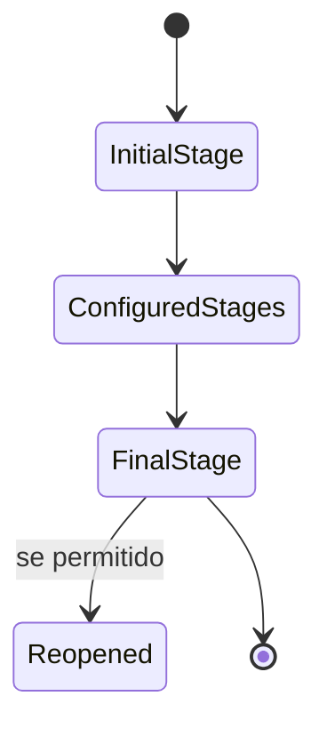

# 07 — Entities

> **Status:** baseline técnica criada antes da análise de um repositório executável.
> Itens marcados como **Planejado** são propostas de arquitetura e não devem ser tratados como já implementados.
> Quando o código existir, `composer.json`, `package.json`, migrations, código-fonte, infraestrutura e testes passam a ser a fonte primária de verificação.

Todas as entidades abaixo são **Planejadas**.

## Tenant

Representa empresa/organização isolada.

Campos conceituais:
- id;
- name;
- is_active;
- timestamps.

## User

Identidade autenticável e ator do sistema.

Campos:
- id;
- tenant;
- name;
- email/login;
- password hash/provedor;
- active.

Relacionamentos:
- requester;
- atendente;
- equipe;
- histórico.

## Department

Setor que recebe chamados.

Tabela proposta: `departments`.

Campos:
- id;
- tenant_id;
- name;
- description?;
- is_active.

## TicketType

Classifica natureza do chamado.

Pode relacionar:
- departamento;
- pipeline padrão;
- categorias.

## Category

Classificação detalhada.

Campos:
- id;
- tenant;
- name;
- parent_id?;
- department_id?/type_id?;
- active.

MVP pode limitar hierarquia a categoria + subcategoria.

## Priority

Representa prioridade configurável.

Campos:
- id;
- tenant;
- name;
- weight;
- color_token?;
- is_active.

## Pipeline

Define fluxo.

Campos:
- id;
- tenant;
- name;
- active.

## PipelineStage

Campos:
- id;
- pipeline_id;
- name;
- position;
- is_initial;
- is_final;
- active.

Regras:
- exatamente uma etapa inicial;
- uma ou mais finais;
- etapa em uso não é removida sem migração.

## PipelineTransition

Movimentação permitida entre etapas.

Campos:
- id;
- pipeline;
- from_stage;
- to_stage;
- name?;
- active.

## Team

Agrupa atendentes.

Relacionamento many-to-many com usuários.

## Ticket

Agregado central.

Campos:
- id;
- tenant_id;
- protocol;
- title;
- description;
- requester_id;
- department_id;
- ticket_type_id;
- category_id?;
- priority_id;
- pipeline_id;
- current_stage_id;
- assigned_user_id?;
- assigned_team_id?;
- version;
- created_at;
- updated_at;
- resolved_at?;
- closed_at?.

O estado operacional vem do pipeline, não de enum rígido.

## TicketComment

Campos:
- ticket;
- author;
- body;
- visibility (`public` / `internal`, se adotado);
- timestamps.

## TicketAttachment

Metadados:
- ticket;
- uploader;
- original_name;
- storage_key;
- mime_type;
- size.

## TicketHistory

Timeline legível:
- actor;
- action;
- before;
- after;
- metadata;
- created_at.

## AuditLog

Auditoria técnica separada da timeline.

## TicketAssignment

Histórico de atribuições.

## TicketSla

**Fase 2.**

Responsável por primeira resposta, resolução, pausas e violações.

## Notification

**Fase 2.**

Notificação interna e leitura, caso adotada.

## AutomationRule

**Fase 3.**

Não modelar profundamente no MVP.

## Lifecycle

Os nomes das etapas vêm da configuração.

## Pontos encontrados durante a análise

Nenhuma entidade foi verificada em código/migration. A modelagem é proposta.
