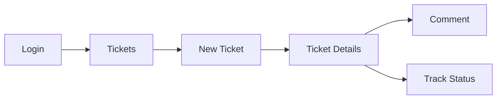
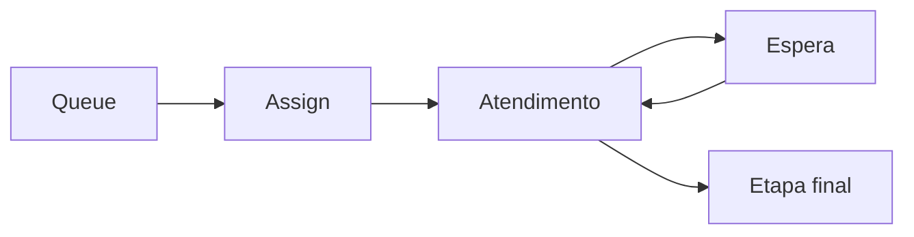

# 08 — Screens and Flows

> **Status:** baseline técnica criada antes da análise de um repositório executável.
> Itens marcados como **Planejado** são propostas de arquitetura e não devem ser tratados como já implementados.
> Quando o código existir, `composer.json`, `package.json`, migrations, código-fonte, infraestrutura e testes passam a ser a fonte primária de verificação.


Todas as telas são **Planejadas**.

## Login

**Rota:** `/login`  
**Acesso:** público.  
Estados: idle, loading, inválido, inativo, erro.

## Dashboard

**Rota:** `/dashboard`  
**Fase:** 2 para métricas avançadas.

Indicadores planejados:
- abertos;
- em atendimento;
- aguardando;
- vencidos;
- resolvidos;
- tempo médio.

## Meus chamados

**Rota:** `/tickets`

Ações:
- filtrar;
- buscar;
- abrir;
- visualizar.

Estados:
- loading;
- empty;
- error;
- success.

## Novo chamado

**Rota:** `/tickets/new`  
**Permissão:** `ticket.create`.

Campos:
- título;
- descrição;
- departamento;
- tipo;
- categoria;
- prioridade conforme política;
- anexos.

```text
Novo chamado
→ validar
→ API
→ backend define pipeline/etapa inicial
→ ticket
→ detalhe
```

## Detalhe do ticket

**Rota:** `/tickets/:id`

Exibe:
- protocolo;
- descrição;
- solicitante;
- classificação;
- prioridade;
- etapa;
- responsável;
- timeline;
- comentários;
- anexos.

Ações conforme permission:
- comentar;
- atribuir;
- prioridade;
- mover;
- fechar/reabrir.

## Central de atendimento

**Rota proposta:** `/queues`

Exibe:
- tickets pendentes;
- filtros;
- ordenação;
- SLA futuro.

## Kanban

**Rota:** `/tickets/board`

Drag-and-drop é UX; backend valida transição. `409` deve recarregar estado e informar conflito.

## Configurações

Rotas planejadas:

```text
/settings/departments
/settings/ticket-types
/settings/categories
/settings/priorities
/settings/pipelines
/settings/teams
/settings/permissions
```

## SLA

`/settings/sla` — **Fase 2**.

## Relatórios

`/reports` — **Fase 2**.

## Automações

`/settings/automations` — **Fase 3**.

## Fluxo do solicitante



## Fluxo do atendente



Os nomes de etapas são exemplos, não enums fixos.

## Mobile

- uma coluna;
- cards no lugar de tabelas largas;
- drawer/fullscreen para ações complexas;
- kanban horizontal;
- ações principais acessíveis.

## Pontos encontrados durante a análise

Nenhuma rota/tela real pôde ser confrontada com frontend existente.
