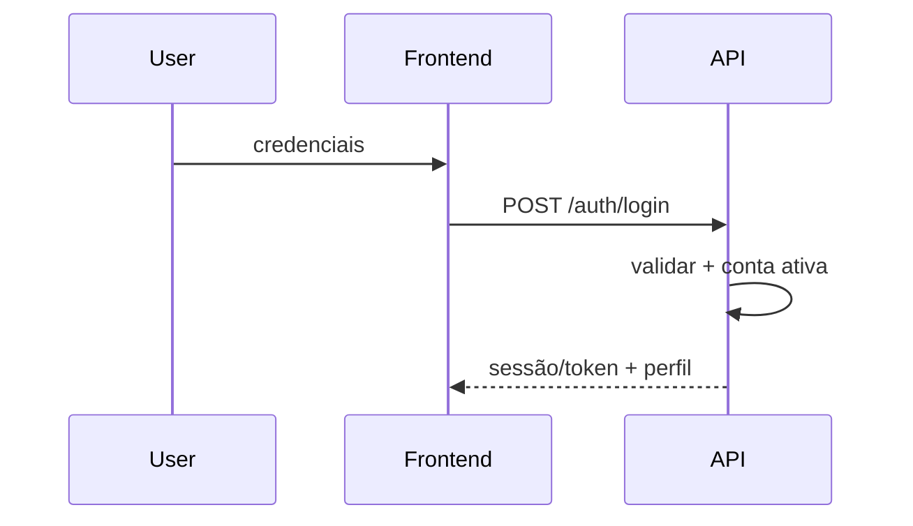

# 12 — Authentication and Permissions

> **Status:** baseline técnica criada antes da análise de um repositório executável.
> Itens marcados como **Planejado** são propostas de arquitetura e não devem ser tratados como já implementados.
> Quando o código existir, `composer.json`, `package.json`, migrations, código-fonte, infraestrutura e testes passam a ser a fonte primária de verificação.


## Estado

Modelo **Planejado**.

## Login



Endpoint exato: a definir.

## Logout

Limpar estado local e invalidar sessão/refresh quando suportado.

## Recuperação de senha

**Planejado.**

- token único;
- expiração;
- não revelar existência do e-mail;
- invalidar após uso.

## Perfis conceituais

### Solicitante

- cria;
- vê próprios;
- comenta;
- acompanha.

### Atendente

- vê autorizados;
- assume/recebe;
- comenta;
- movimenta conforme permission.

### Supervisor

- gerencia fila;
- atribui;
- prioridade;
- visão ampliada.

### Administrador configurador

Configura módulo somente com permissions específicas.

### Superadmin

**Não implementado atualmente.** Só adotar se arquitetura global exigir.

## Permissions planejadas

```text
ticket.create
ticket.view
ticket.view_all
ticket.update
ticket.assign
ticket.change_priority
ticket.move_pipeline
ticket.comment
ticket.comment_internal
ticket.close
ticket.reopen

ticket.settings.manage
ticket.department.manage
ticket.type.manage
ticket.category.manage
ticket.priority.manage
ticket.pipeline.manage
ticket.queue.manage
ticket.notification.manage
ticket.sla.manage
```

Não assumir que role `ADMIN` concede tudo automaticamente.

## Matriz

| Recurso | Solicitante | Atendente | Supervisor | Admin config |
|---|---:|---:|---:|---:|
| Criar ticket | ✅ | ✅ | ✅ | ✅ |
| Ver próprios | ✅ | ✅ | ✅ | ✅ |
| Ver todos autorizados | ❌ | ✅* | ✅ | ✅* |
| Comentar | ✅ | ✅ | ✅ | ✅ |
| Nota interna | ❌ | ✅* | ✅ | ✅* |
| Atribuir | ❌ | ✅* | ✅ | ✅* |
| Prioridade | ❌ | ✅* | ✅ | ✅* |
| Mover pipeline | ❌ | ✅* | ✅ | ✅* |
| Gerenciar departamentos | ❌ | ❌ | ❌* | ✅* |
| Gerenciar pipelines | ❌ | ❌ | ❌* | ✅* |

`*` depende de permission explícita.

## Criação

```text
Admin autorizado
→ cria/convida
→ vincula tenant
→ roles/permissions
→ ativação
→ acesso
```

## Desativação

Usuário inativo:
- não autentica;
- mantém autoria histórica;
- continua referenciado em audit log/tickets.

## Sem acesso

Frontend melhora UX; backend retorna `403` e não executa.

## Pontos encontrados durante a análise

Roles, login, RBAC/ABAC e superadmin reais ainda não foram localizados.
